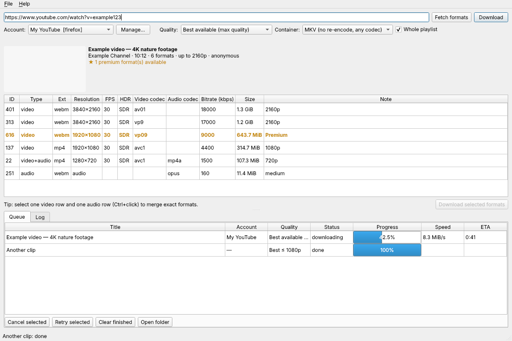

# yt-dlp GUI

A desktop front end for [yt-dlp](https://github.com/yt-dlp/yt-dlp) for **Windows and Linux**, built with
Python + PySide6 (Qt). It uses yt-dlp as a library, so it shows live progress and needs no separate yt-dlp install.



## Features
- Paste one or more URLs, or drag them onto the window. Click **Download** to use a quality preset, or
  **Fetch formats** to see every format and pick exact video and audio streams.
- **Accounts** that let you download as a signed-in user, so you get the best quality available
  (see below). The right account is picked automatically based on the site.
- Quality presets: best available, ≤4K, ≤1440p, ≤1080p, ≤720p, ≤480p, best audio, and MP3.
  "Best" sorts by resolution, then fps, then HDR, then codec, then bitrate.
- Container choice: MKV (default, never re-encodes), MP4 or WebM.
- A queue that runs several downloads at once, with progress, speed and ETA, plus cancel and retry.
- Options to embed metadata, chapters, thumbnails and subtitles, and to cut out SponsorBlock segments.
  You can also set a rate limit and a custom filename template.
- Premium-only formats (such as YouTube's enhanced-bitrate 1080p, format 616) are highlighted.

## Accounts: getting the best quality
Some formats are only offered to signed-in users: YouTube Premium enhanced bitrate, members-only videos,
age-restricted videos, and paid or subscriber content on other sites. This app uses yt-dlp's
`--cookies-from-browser`, which reuses the login from a browser you already use:

1. Sign in to the site in your normal browser.
2. In the app, go to **File → Accounts… → Add**. Choose the browser and the profile (installed browsers
   and their profiles are detected automatically). Under **Sites**, list the sites this account is for,
   e.g. `youtube.com`.
3. Click **Test account**. It reads the cookies and tells you whether a login was found for each site.
4. Pick the account in the main window. URLs from the listed sites select it automatically.

The app never stores a password. It reads the browser's cookies each time it downloads, so the session
stays as fresh as the browser's.

**Platform notes**
- **Firefox is the most reliable browser on both operating systems.**
- **Windows:** Chrome, Edge and Brave lock their cookie database while running, so close them fully,
  including background or tray processes. Recent versions also use "app-bound" cookie encryption, which
  can stop any outside tool from reading cookies. If the test fails, use Firefox.
- **Linux:** if Chromium-based cookies can't be decrypted, set the keyring explicitly: `GNOMEKEYRING`
  for GNOME, `KWALLET6` or `KWALLET5` for KDE. Browsers installed as Flatpak or Snap are detected too.

## Requirements
- **ffmpeg.** It's needed to merge the separate best-video and best-audio streams, which is how the
  highest qualities are delivered. Linux: `sudo apt install ffmpeg`. Windows: `winget install ffmpeg`,
  or put `ffmpeg.exe` in a `bin\` folder next to the app.
- **Deno (recommended for YouTube).** Current yt-dlp needs a JavaScript runtime to solve YouTube's
  challenges. Without it, some formats may be missing. Install it from https://deno.com. On Windows you
  can run `winget install DenoLand.Deno`.

## Run from source
```bash
python -m pip install -e ".[dev]"
ytdlp-gui            # or: python -m ytdlp_gui [URL...]
```
Python 3.9+ is required. Settings are saved in the OS config folder: `%APPDATA%\ytdlp-gui` on Windows,
`~/.config/ytdlp-gui` on Linux.

Keep yt-dlp current: sites change often. Use **Settings → Update yt-dlp** when running from source, or
download a newer build otherwise.

## Build standalone apps
Linux. Builds `dist/ytdlp-gui/ytdlp-gui` and a `.tar.gz`:
```bash
FFMPEG=/usr/bin/ffmpeg ./packaging/build_linux.sh    # FFMPEG is optional; it bundles ffmpeg
```
Windows (PowerShell). Builds `dist\ytdlp-gui\ytdlp-gui.exe` and a `.zip`:
```powershell
.\packaging\build_windows.ps1 -Ffmpeg C:\ffmpeg\bin\ffmpeg.exe   # -Ffmpeg is optional
```
PyInstaller can't cross-compile, so build each platform's version on that platform.

## Tests
```bash
QT_QPA_PLATFORM=offscreen python -m pytest
```

## Legal
Only download content you have the right to download, and follow each site's terms of service.
